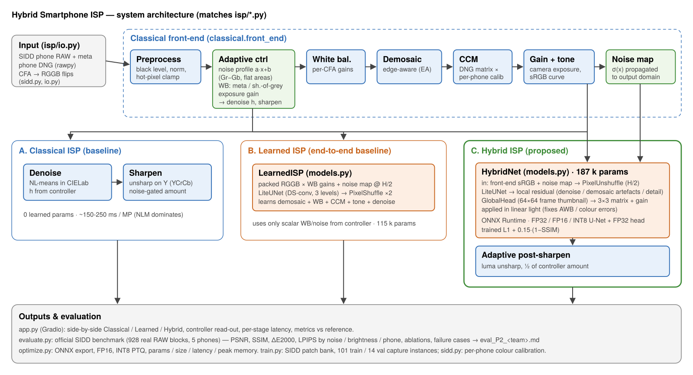
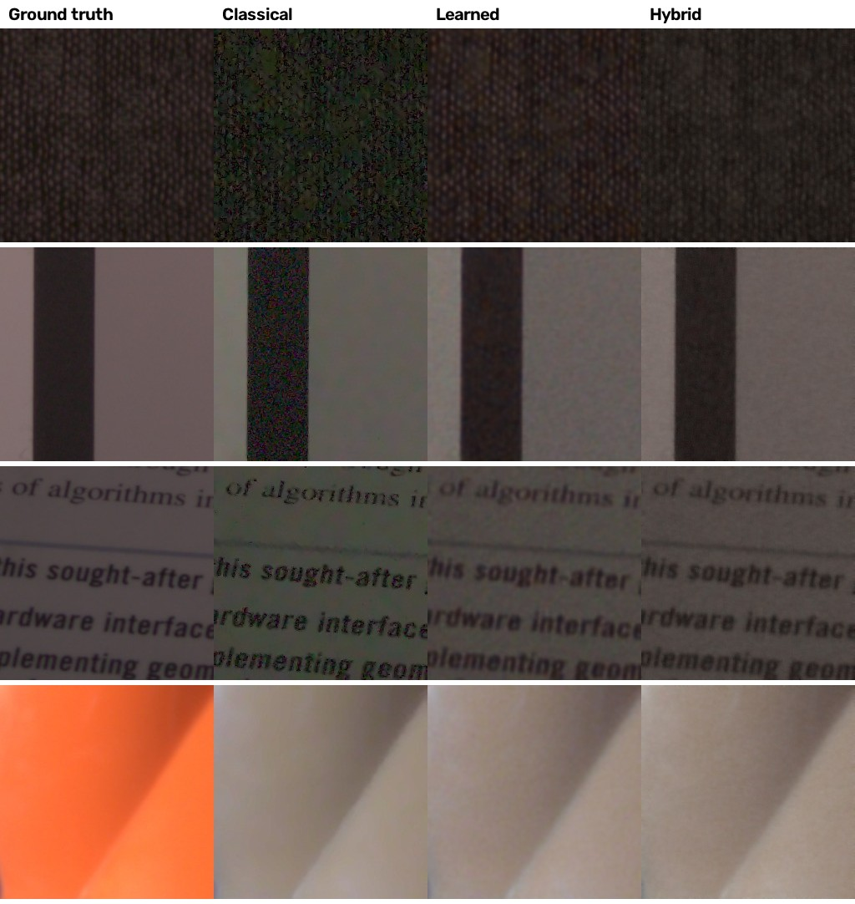
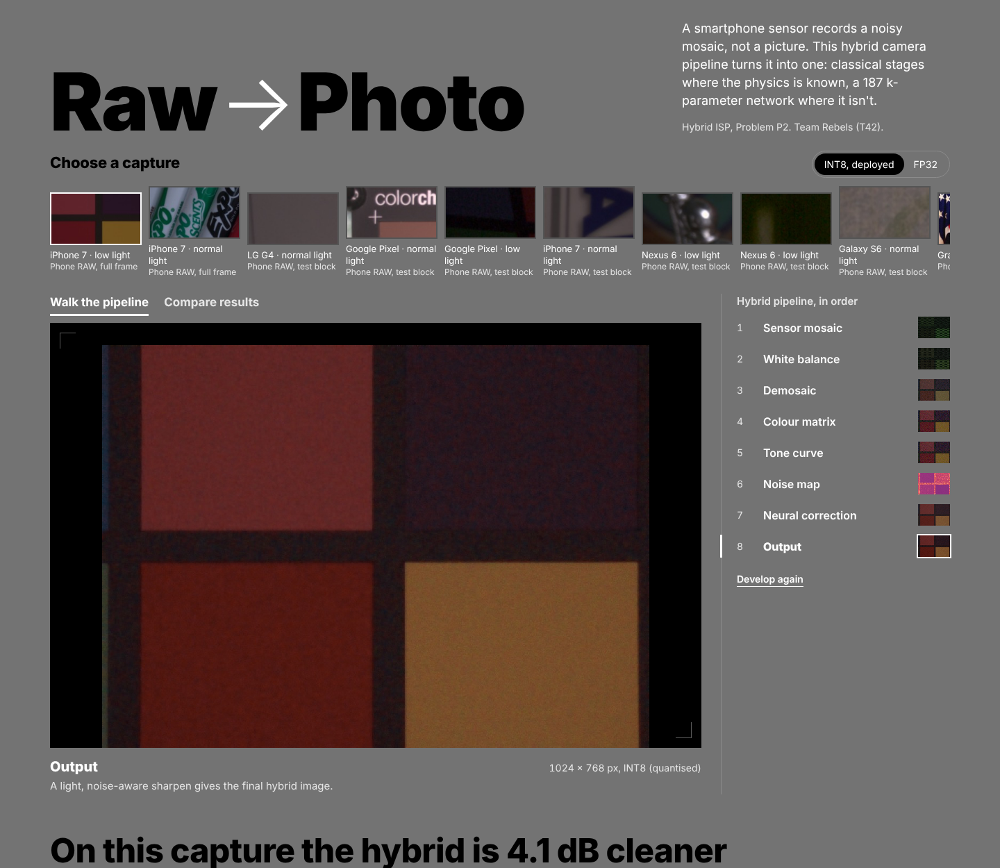

# Hybrid Smartphone ISP (Problem P2)

A RAW → sRGB image signal processor for **real smartphone RAW**. It combines a **classical ISP**
(black level, CFA alignment, noise profiling, white balance, edge-aware demosaic, calibrated colour
matrix, sRGB tone, NLM denoise, luma sharpening) with a **187 k-parameter learned stage**: a
noise-conditioned residual U-Net plus a global colour head working in linear light. The learned
stage is quantised to INT8 and served as a web app.

A classical baseline and a pure end-to-end learned ISP are built alongside it. All three are
trained and tested on **SIDD**, real noisy RAW from 5 phones.



## Results — official SIDD benchmark (928 real RAW blocks, never seen in training)

| Pipeline | PSNR ↑ | SSIM ↑ | ΔE2000 ↓ | LPIPS ↓ | Params | Size | Latency 1 MP |
|---|---|---|---|---|---|---|---|
| Classical ISP | 26.25 | 0.724 | 10.65 | 0.448 | 0 | – | 536 ms |
| Learned ISP (FP32) | **29.22** | **0.883** | 8.07 | **0.272** | 115 k | 463 KB | 200 ms |
| Learned ISP (INT8) | 28.69 | 0.864 | 8.83 | 0.287 | 115 k | 202 KB | 180 ms |
| Hybrid ISP (FP32) | 29.17 | 0.868 | **7.85** | 0.277 | 187 k | 752 KB | 346 ms |
| **Hybrid ISP (INT8, deployed)** | **29.12** | 0.865 | **7.86** | 0.286 | 187 k | 488 KB | 285 ms |

- **Gain over the conventional baseline:** about +3 dB, with the largest gains on dark scenes (+5.6 dB) and high noise (+3.1 dB).
- **Hybrid vs learned in FP32:** they tie on PSNR, and the hybrid has the best colour accuracy.
- **After quantisation:** the hybrid loses only 0.05 dB with mixed-precision INT8, while the learned ISP loses 0.5 dB. That makes the hybrid the best deployable model.
- **Main failure case:** white balance on single-colour close-ups, which every pipeline shares.

Full tables are in [`eval_P2_T42.md`](eval_P2_T42.md), and the analysis is in [`docs/DESIGN.md`](docs/DESIGN.md) §10.



## Quick start (web app)

```bash
pip install -r requirements.txt
python app.py                      # → http://localhost:7860
# or
docker build -t hybrid-isp . && docker run -p 7860:7860 hybrid-isp
```

Batch inference on a folder (writes one PNG per input and pipeline, plus `metrics.csv`):

```bash
python run_inference.py --input_dir ./examples/ --output_dir ./results/inference/ --pipeline all
```

The main page is a custom front-end (`web/index.html`, served by FastAPI in `app.py`):
**Walk the pipeline** steps one image through all eight hybrid stages (sensor mosaic, white balance,
demosaic, colour matrix, tone curve, noise map, neural correction, output); **Compare results** puts
a four-way loupe (classical | learned | hybrid | ground truth) under the cursor. The previous Gradio
interface is still available at `/classic`, and the JSON API at `/api/run` (docs at `/api/docs`).



The app accepts three kinds of input:

- **Real SIDD RAW examples** (`.npz`), with ground truth, so metrics are shown.
- **Your own phone DNG.** The as-shot white balance and colour matrix are read from the file.
- **Any JPG/PNG.** It is converted into a simulated sensor RAW.

For each input the app shows the visualised RAW, the classical, learned and hybrid outputs, the adaptive controller's decisions, the metrics and the per-stage latency.

## Reproduce everything

```bash
pip install -r requirements-train.txt
bash scripts/download_sidd.sh                 # ~7.5 GB SIDD subset → ../sidd (from Hugging Face)
python -c "from isp.sidd import *; fit_calibration(split_names(train_names())[0])"   # per-phone colour calibration
python train.py --model hybrid  --iters 4000
python train.py --model learned --iters 4000
python train.py --model hybrid_nonoise  --iters 4000   # ablation
python train.py --model hybrid_noglobal --iters 4000   # ablation
python optimize.py                                     # ONNX, FP16, mixed-precision INT8, size/latency/memory
python evaluate.py --team T01 --usns "USN1,USN2,..."   # official benchmark → eval_P2_T01.md + results/
```

Seeds are fixed. Latency varies with the CPU.

## Data and splits

[SIDD](https://abdokamel.github.io/sidd/) (Abdelhamed, Lin & Brown, CVPR 2018), via the SIDD-CC release on Hugging Face.

- **Input:** real noisy Bayer RAW with DNG metadata (white balance, colour matrix, CFA pattern).
- **Target:** SIDD's clean sRGB ground truth.
- **Train / validation:** 101 / 14 capture instances, stratified by phone.
- **Test:** the official 928-block benchmark, which is used only by `evaluate.py`.

## Repository layout

| Path | What |
|---|---|
| `isp/sidd.py` | SIDD loading, CFA→RGGB flips, metadata → WB / colour matrix, per-phone calibration, patch banks, test blocks |
| `isp/classical.py` | classical stages + adaptive controller (noise profile, WB, exposure, denoise/sharpen strength) |
| `isp/models.py` | `LiteUNet`, `HybridNet` (proposed), `LearnedISP` (end-to-end baseline) |
| `isp/data.py` | network inputs: noise maps, whole-frame thumbnail |
| `isp/engine.py` | ONNX Runtime inference for all three pipelines (no PyTorch needed at runtime) |
| `isp/io.py` | DNG (rawpy) / `.npz` / `.npy` / JPG loading, CFA alignment, input validation |
| `isp/metrics.py` | PSNR, SSIM, CIEDE2000, LPIPS, GMSD |
| `isp/raw_sim.py` | sensor simulator (JPG/PNG demo inputs only) |
| `isp/camera_calib.json` | fitted per-phone colour calibration |
| `train.py`, `optimize.py`, `evaluate.py` | training, optimisation, evaluation |
| `run_inference.py` | batch CLI: folder in → PNGs + metrics.csv out |
| `scripts/make_intermediates.py` | intermediate-representation figure → `docs/intermediates.jpg` |
| `models/` | exported FP32 / FP16 / INT8 ONNX models |
| `docs/DESIGN.md`, `docs/architecture.*` | design document and architecture diagram |
| `docs/SOLUTION_REPORT.md` | hackathon solution report (submission template) |
| `eval_P2_T42.md`, `results/` | evaluation report, per-block metrics, ablation, failure-case panels |

## Deploying the live URL (Hugging Face Spaces, free CPU)

1. Create a new Space with SDK **Docker**.
2. Push this repo to it. The models are under 1 MB each; `checkpoints/bank_*` are git-ignored.
3. The Space builds from the `Dockerfile` and serves on port 7860.

The same Dockerfile works on Render, Railway or Fly.io, since the `PORT` environment variable is respected. No secrets are used.
