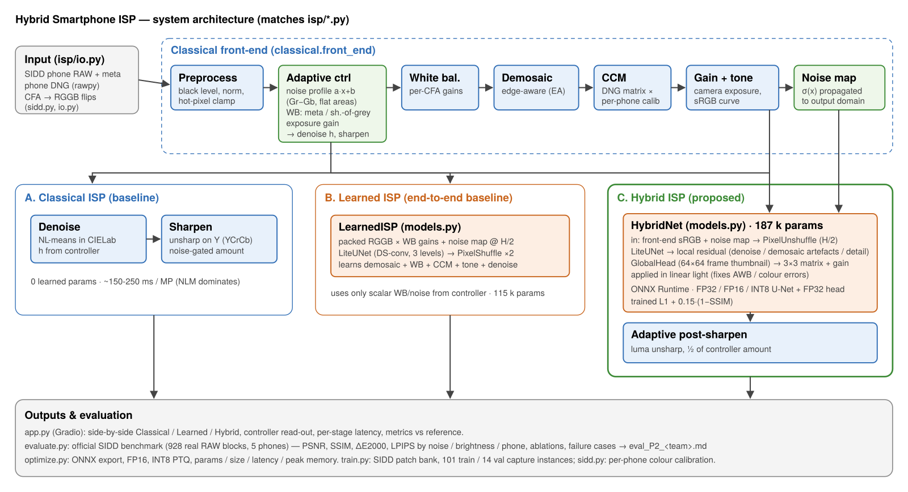
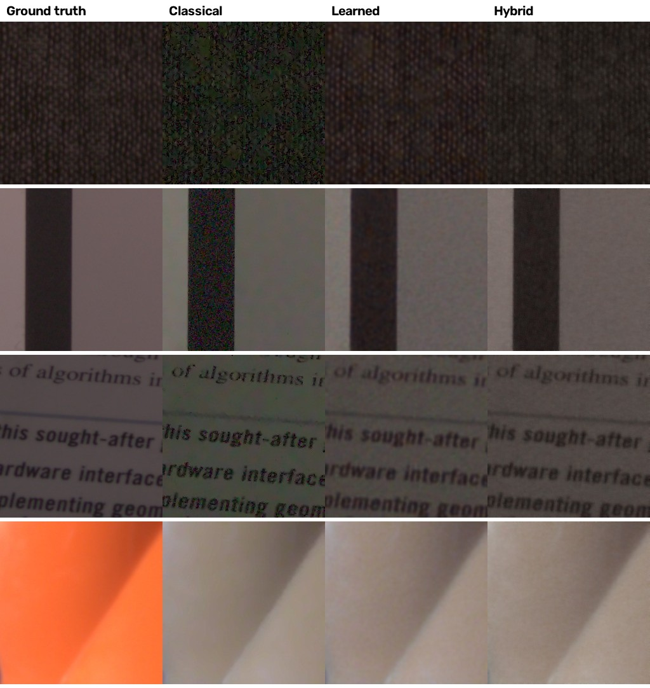

# Design Document — Intelligent & Computationally Efficient Smartphone ISP (P2)

## 1. Problem statement

Turn degraded Bayer RAW sensor data from a smartphone into high-quality sRGB under mobile
constraints, handling sensor noise, colour distortion, varying illumination, white-balance error
and artefacts — with a **hybrid** architecture (classical ISP stages + learned components),
measured on quality (PSNR, SSIM, ΔE2000, LPIPS) and efficiency (parameters, size, latency, memory).

## 2. Goals and non-goals

| Goals | Non-goals (for this prototype) |
|---|---|
| RAW→sRGB on **real** phone RAW, evaluated on an official benchmark | Burst / multi-frame fusion (HDR+, night mode) |
| Classical, learned and hybrid pipelines compared on identical inputs | On-device Android/iOS deployment — CPU proxies are measured instead |
| Adaptive behaviour driven by measured noise and illumination | Semantic / face-aware tone mapping |
| Neural stage < 1 MB, ~100 ms per MP on 2 CPU threads | Photographic "look" beyond the dataset's reference rendering |

## 3. System overview



| Diagram block | Code |
|---|---|
| Input / RAW decoding | `isp/io.py` (`load_camera_raw` for phone DNG via rawpy, `load_npz_frame`, `load_npy_bayer`, `load_srgb`) |
| Real dataset, CFA alignment, metadata, calibration | `isp/sidd.py` (`to_rggb`, `ccm_from_colormatrix`, `wb_from_neutral`, `fit_calibration`, `build_sidd_bank`, `load_test_blocks`) |
| Classical front-end + adaptive controller | `isp/classical.py` (`preprocess`, `analyze`, `estimate_noise_profile`, `estimate_wb`, `auto_exposure_gain`, `apply_wb`, `demosaic`, `apply_ccm`, `tone_map`, `front_end`) |
| Classical back-end | `isp/classical.py` (`denoise`, `sharpen`, `classical_isp`) |
| Learned components | `isp/models.py` (`LiteUNet`, `HybridNet`, `GlobalHead`, `LearnedISP`) |
| Model inputs / noise map / thumbnail | `isp/data.py` (`hybrid_inputs`, `learned_inputs`, `make_thumb`) |
| Inference engine (ONNX Runtime) | `isp/engine.py` |
| Sensor simulator (JPG demo input only) | `isp/raw_sim.py` |
| Training / optimisation / evaluation | `train.py`, `optimize.py`, `evaluate.py` |
| Web application | `app.py`, `Dockerfile` |

## 4. Data — SIDD (real smartphone RAW)

We use the **Smartphone Image Denoising Dataset** (Abdelhamed, Lin & Brown, CVPR 2018), one of
the two datasets named in the brief, through its SIDD-CC release on Hugging Face
(`MhdMohammadi/SIDD-CC`), which ships noisy RAW, DNG metadata and clean ground truth in one place.

* **Input:** real noisy Bayer RAW (black-level subtracted, normalised) from five phones —
  Google Pixel, iPhone 7, Nexus 6, LG G4, Galaxy S6 — ISO 50–10 000, 3200/4400/5500 K
  illuminants, normal and low brightness.
* **Metadata used:** `AsShotNeutral` (white balance), `ColorMatrix2` (XYZ→camera) and `cfa_str`.
* **Target:** SIDD's clean sRGB ground truth (the average of ~150 aligned frames, rendered by the
  dataset's camera pipeline), pixel-aligned with the RAW.

**Bayer layouts.** The phones use RGGB, GRBG and BGGR. Each frame is flipped so that it reads RGGB
(lossless; flips are their own inverse) and flipped back for display, so every stage and both
networks only ever see RGGB.

**Splits (no leakage).**

| Split | What | Used for |
|---|---|---|
| Train | 101 capture instances (one full 12-16 MP frame each), stratified per phone | training, colour calibration, INT8 calibration |
| Validation | 14 held-out capture instances | checkpoint selection only |
| **Test** | **official SIDD benchmark: 29 instances × 32 blocks of 256×256 = 928 blocks** | final numbers only |

The official test set ships **without per-image metadata**, so at test time white balance is
estimated by every pipeline (the hard, realistic case); the camera is identified from the source
resolution, which gives the CFA and the calibrated colour matrix.

**Patch bank.** Each 256×256 RAW crop is processed *as a complete frame*, like a benchmark block or an app upload: the
controller measures noise on it, white balance is estimated from it (or, for half of the crops,
taken from metadata, as on a phone), the front-end
renders it, and two random 128×128 patches are stored with the crop's thumbnail.
6 060 training and 224 validation patches.

## 5. Classical computer-vision stages

| Stage | Method | Why this choice |
|---|---|---|
| Bayer preprocessing | black level, normalisation, CFA→RGGB flips, per-plane hot-pixel clamp | standard first stage; clamp stops salt noise surviving demosaic |
| Noise estimation | fit `var(x)=a·x+b` from (Gr−Gb)/√2 in flat regions, robust MAD per brightness bin | the two greens see the same scene, so their difference is noise; gives a *signal-dependent* (shot + read) profile from the frame itself |
| White balance | `AsShotNeutral` when the file has it; otherwise shades-of-grey (Minkowski p = 6) on the packed CFA, excluding clipped/dark pixels | metadata is what a phone ISP has; the estimator is the fallback the test set forces |
| Demosaicing | OpenCV edge-aware (EA) interpolation | fewer zipper artefacts than bilinear at the same cost |
| Colour correction | camera→sRGB from the DNG `ColorMatrix2` × a **per-phone 3×3 calibration** fitted by least squares on training frames | ColorMatrix alone leaves a consistent ~+18 % red error against the reference rendering; calibration is a standard factory ISP step (+2.4 dB measured) |
| Exposure + tone | real RAW: gain 1 (the phone already exposed), plain sRGB curve; simulated input: auto-exposure + highlight knee | matches how the reference was rendered |
| Denoising | non-local means in CIELab (luma h, chroma 1.5h), h from the measured noise; bilateral (YCrCb) as fast option | edge-preserving; chroma denoised harder since colour noise is most objectionable |
| Sharpening | unsharp mask on Y of YCrCb, soft-thresholded detail, amount from the measured noise | sharpen luma only so colour noise is not amplified |
| Colour spaces | linear ↔ sRGB, RGB ↔ YCrCb, RGB ↔ CIELab, camera RGB ↔ XYZ ↔ sRGB | each stage works where its assumptions hold |

**Adaptive controller (`analyze`).** One pass over the RAW gives the noise profile, white balance
(metadata or estimated), exposure gain, the noise σ predicted in the output domain, and a scene
label. These set the NLM strength (`h ∝ σ_out`), the sharpening amount (`0.7 − 6σ_out`, off for
very noisy frames), and produce the per-pixel noise map and thumbnail that condition the hybrid
network.

## 6. Learned components

**LiteUNet** — 3-level U-Net of depthwise-separable residual blocks (24/48/96 channels),
strided-conv down / transposed-conv up, skip concatenations; ~8× fewer multiply-adds than plain
3×3 convolutions at the same width.

**LearnedISP (pure learned baseline, PyNET / U-Net-ISP style)** — packed RGGB (H/2×W/2×4) with
the same scalar white-balance gains, plus a noise map → 12 channels →
PixelShuffle → sRGB. It must
learn demosaicing, colour correction, tone curve and denoising itself. 115 k parameters.

**HybridNet (proposed learned stage)** — input: the classical front-end output (demosaiced,
white-balanced, colour-corrected, gamma-encoded) + the per-pixel noise map, PixelUnshuffled to
H/2 so it costs about the same as the baseline. Two outputs:

* **Local residual** from the U-Net: denoising, demosaic-artefact removal, detail restoration,
  conditioned on the measured noise (one network for every ISO).
* **Global colour/exposure head** on a fixed 64×64 thumbnail of the **whole frame** (RGB + noise
  map): a 3×3 matrix
  `M = I + 0.5·tanh(·)` and log-gain `k`, applied in **linear light**:
  `y = OETF(M · EOTF(x + r) · e^k)` — a learned colour transformation that fixes residual AWB
  and colour-matrix error, constrained so it cannot hallucinate spatial content.

187 k parameters (131 k U-Net + 56 k head). Training (both nets identical): AdamW, one-cycle LR
2e-3, batch 16, 4 000 iterations, loss `L1 + 0.15·(1 − SSIM)` in sRGB, best checkpoint by
validation PSNR.

**Design iteration worth knowing (viva).** The first hybrid pooled the global head from the U-Net
bottleneck. It looked good on 128-px validation patches but lost ~2.5 dB on full frames because
mean/max pooling statistics change with image size (tile-by-tile inference recovered the loss,
which isolated the cause). Feeding the head a fixed-size thumbnail of the whole frame — stored
with every training patch — removed the mismatch (HDRNet uses the same idea).

**Known issue, fix designed but not yet trained (found while testing the app on larger held-out SIDD crops).** With correct
metadata white balance, both networks added a warm cast (+0.05 red) and lost ~5 dB to the
classical ISP on some scenes. Cause: half the training crops used *estimated* white balance, whose
errors have a systematic direction, and the networks could not tell the two cases apart, so they
always applied an "average correction". Fix (next step): a WB-source flag input (metadata vs
estimated) so they correct only when the estimate is untrusted, and training on 256/512/768-px
crops for the thumbnail scale mismatch on full-size uploads. Affects metadata-WB inputs (phone
DNGs), not the benchmark numbers (test set has no metadata).

## 7. Hybrid processing sequence (why this order)

```
RAW → black level / CFA→RGGB / hot pixels → [measure noise profile, illuminant]
    → WB → demosaic (EA) → calibrated CCM → tone/gamma        (cheap, exact, interpretable)
    → HybridNet: noise-conditioned residual + global colour fix   (learned)
    → noise-gated luma sharpening                                 (cheap, tunable)
```

* WB, demosaic, colour matrix and gamma are cheap and exactly known from metadata — no network
  capacity is spent re-learning them, and a **new phone** only needs its DNG colour matrix,
  whereas the pure learned ISP has to be retrained for each sensor.
* Denoising and colour-error correction are where classical heuristics fail (NLM smears texture,
  AWB fails on coloured scenes) — the network takes these over, guided by the measured noise.
* Final sharpening stays classical so it can be tuned at run time.

## 8. Optimisation

`optimize.py` exports both networks to ONNX (dynamic H×W) and produces:

* **FP16 (reduced precision):** weights stored in half precision (size ÷2).
* **INT8 post-training static quantisation:** ONNX Runtime QDQ, per-channel INT8 weights, UINT8
  activations, percentile (99.99) calibration on 96 SIDD training patches. **Mixed precision for
  the hybrid:** the U-Net (>99 % of FLOPs) is INT8; the 56 k-parameter colour head and the
  linear-light transform stay FP32. Fully quantising the head cost 0.45 dB (a 3×3 colour matrix is
  very sensitive to rounding); mixed precision costs ≈0.05 dB.

For each variant: file size, median latency of 7 runs at 512² and 1024², peak resident memory
(sampled every 2 ms in an isolated process). The app runs INT8 by default with an FP32 toggle
and needs no PyTorch at runtime.

## 9. Evaluation protocol

`evaluate.py` runs every pipeline and ablation on the same 928 official SIDD benchmark blocks.
Metrics: PSNR, SSIM, mean CIEDE2000 ΔE, **LPIPS (AlexNet)**, GMSD; parameters, size, end-to-end
latency per stage on a real 1 MP frame, neural-stage peak memory. Robustness is reported across
real conditions: thirds of the *measured* noise level, thirds of scene brightness, and per phone.

## 10. Results, ablation and failure-case analysis

Full tables: `eval_P2_T42.md`; per-block rows: `results/eval_rows.json`.



*Official SIDD test blocks. Rows: dark fabric (high noise), flat card, text, and the main failure
case (a single-colour orange object). Columns: ground truth, classical, learned, hybrid.*

### 10.1 Headline (928 official SIDD benchmark blocks)

| Pipeline | PSNR | SSIM | ΔE2000 | LPIPS | Size | Latency 1 MP |
|---|---|---|---|---|---|---|
| Classical | 26.25 | 0.724 | 10.65 | 0.448 | – | 536 ms |
| Learned FP32 | **29.22** | **0.883** | 8.07 | **0.272** | 463 KB | 200 ms |
| Learned INT8 | 28.69 | 0.864 | 8.83 | 0.287 | 202 KB | 180 ms |
| Hybrid FP32 | 29.17 | 0.868 | **7.85** | 0.277 | 752 KB | 346 ms |
| **Hybrid INT8 (deployed)** | **29.12** | 0.865 | **7.86** | 0.286 | 488 KB | 285 ms |

* Both learned pipelines beat the conventional ISP baseline by **~+3 dB PSNR, +0.14–0.16 SSIM,
  −2.6 to −2.8 ΔE and −0.17 LPIPS** on real phone RAW they never saw.
* In FP32 the hybrid and the pure learned ISP are tied on PSNR (−0.05 dB); the hybrid has the
  **best colour accuracy** (ΔE 7.85 vs 8.07), the learned ISP slightly better SSIM/LPIPS (it
  smooths more).
* **After optimisation the hybrid wins:** mixed-precision INT8 costs it 0.05 dB, while full INT8
  costs the learned ISP 0.53 dB and +0.76 ΔE — so among deployable (INT8) models the hybrid is
  best on PSNR (+0.43 dB) and ΔE (−0.97).
* Gains are largest where the classical ISP struggles: **dark scenes +5.6 dB** (26.4 → 32.0),
  **high noise +3.1 dB** (24.8 → 27.9). They are smallest on bright, colourful blocks, where white
  balance — shared by all pipelines — dominates the error.
* The classical ISP spends 87 % of its time in NL-means; the hybrid replaces it with a cheaper and
  much better learned denoiser (285 ms vs 536 ms per MP).

### 10.2 Optimisation

| | Size | NN latency 1024² | NN peak memory 1024² | Quality cost |
|---|---|---|---|---|
| Hybrid FP32 → mixed INT8 | 752 → 488 KB (−35 %) | 162 → 153 ms | 364 → 225 MB (−38 %) | −0.05 dB |
| Hybrid FP32 → FP16 weights | 752 → 395 KB (−47 %) | ≈ same | ≈ same | – |
| Learned FP32 → INT8 | 463 → 202 KB (−56 %) | 132 → 107 ms (−19 %) | 290 → 209 MB (−28 %) | −0.53 dB |

FP16 halves storage but gives no speed-up on this CPU (no FP16 kernels); INT8 cuts memory and
latency. Quantising the hybrid's 3×3 colour head was the one thing that hurt (−0.45 dB), hence
the mixed-precision choice.

### 10.3 Ablation (what each component is worth, on the test set)

| Variant | PSNR | ΔE | Reading |
|---|---|---|---|
| Classical, no WB | 19.81 | 19.9 | white balance is the most important single stage (−6.4 dB) |
| Classical, nominal instead of calibrated camera CCM | 23.94 | 14.2 | per-phone colour calibration is worth +2.3 dB / −3.5 ΔE |
| Classical, no denoise | 23.79 | 13.7 | denoising worth +2.5 dB |
| Classical, bilateral instead of NLM | 27.35 | 10.0 | bilateral beats our NLM by +1.1 dB — NLM's strength mapping over-smooths; honest tuning gap in the baseline |
| Classical, non-adaptive (fixed h / sharpen) | 26.41 | 10.6 | on SIDD the adaptive NLM rule does **not** help (−0.16 dB) — same tuning issue |
| Classical, bilinear demosaic / no sharpen | 26.47 / 26.39 | 10.6 | edge-aware demosaic and sharpening are ≈ neutral at this noise level |
| Hybrid, front-end only (no network) | 23.93 | 13.7 | **the network adds +5.2 dB / −5.8 ΔE** over its classical input |
| Hybrid, no global colour head | 29.02 | 8.26 | head worth +0.15 dB, −0.41 ΔE, +0.027 SSIM |
| Hybrid, no noise-map conditioning | 29.27 | 7.93 | no measurable gain from the explicit noise map on SIDD (+0.10 dB without it, ΔE +0.08) — the net infers noise from the image itself |
| Hybrid, no post-sharpen | 29.19 | 7.85 | final sharpening is neutral (−0.02 dB) |

### 10.4 Failure-case analysis

1. **White balance on single-colour scenes (main failure, 42 / 928 blocks, all pipelines
   < 18 dB).** The official test blocks have no metadata, so the illuminant is estimated from a
   256×256 patch. When the patch is one saturated colour (orange cylinder, yellow surface — row 4
   of the figure), shades-of-grey assumes the scene averages to grey and "neutralises" the object
   into beige. Every pipeline inherits that estimate, so all three fail together (≈11 dB). The
   learned global head cannot fix it because the patch contains no neutral reference. Fixes: use
   the phone's as-shot white balance (what the app does for DNGs), estimate on the full frame, or
   a learned illuminant estimator (FC4 / FFCC) trained on SIDD's `AsShotNeutral`.
   Excluding these blocks: classical 26.8, learned 29.9, hybrid 29.8 dB.
2. **Classical NLM in dark, noisy scenes** leaves blotchy chroma noise and a green cast (row 1):
   NLM runs on 8-bit gamma data with one strength per frame. The networks remove it (+5.6 dB on
   dark blocks).
3. **Hybrid vs learned texture trade-off.** The hybrid keeps slightly more residual grain on flat
   dark areas (LPIPS 0.277 vs 0.272); the learned ISP is smoother. A perceptual (LPIPS) loss term
   would target this.
4. **Google Pixel is the hardest phone for every pipeline** (27.1 dB hybrid vs 29.8–31.0 dB on the
   others); its test captures are darker and noisier.
5. **Validation (34.1 dB) vs test (29.2 dB) gap.** Half of the validation crops use metadata white
   balance; the test set never has it — the gap is mostly failure 1, not over-fitting.

## 11. Limitations (stated honestly)

* **Training scale:** 101 SIDD captures (6 060 patches), 4 000 iterations (~20 min on 2 CPU
  threads). More data and longer GPU training would raise all learned numbers.
* **Reference rendering = SIDD's pipeline.** The metrics reward reproducing SIDD's look (plain
  sRGB curve, no local tone mapping); a different but pleasing rendering is penalised.
* **Phones outside SIDD:** DNGs from other phones use their own DNG colour matrix plus the
  *average* SIDD calibration; quality there is shown qualitatively (no ground truth).
* **JPG/PNG demo inputs** go through a sensor simulator (`raw_sim.py`) that the networks were not
  trained on; real RAW is the intended input.
* **Latency on a 2-thread x86 CPU** as a proxy for a phone CPU; no NPU/GPU delegate measured.

## 12. Ethics and responsible use

* SIDD is used under its terms of use for research; no personal data is collected, and the demo
  processes uploads in memory without storing them.
* A learned ISP can alter content (smooth away or invent texture). The hybrid limits the learned
  global change to a 3×3 colour matrix + gain, and the residual is noise-conditioned; outputs
  should still not be used as forensic evidence.
* Colour fidelity is measured overall (ΔE2000), not per skin tone; a fairness audit on diverse
  portraits is needed before product use, especially given failure case 1.

## 13. Next steps (in priority order)

1. Learned illuminant estimation from SIDD `AsShotNeutral` (attacks failure case 1, the largest error source).
2. Train on all 230 SIDD pairs + the Modular Neural ISP data; LPIPS / ΔE loss terms.
3. Knowledge distillation: a larger hybrid teacher → the current 187 k student.
4. Mobile benchmark via ONNX Runtime Mobile / TFLite with XNNPACK or NNAPI on an Android phone.

## 14. Team roles

Team **Rebels**

| Member (USN) | Owns | Can explain |
|---|---|---|
| Titiksha Surana (1RUA24CSE0507) | classical stages, adaptive controller, calibration | `isp/classical.py`, `isp/sidd.py` (calibration) |
| Pranaith Rushi Raju (1RUA24CSE0509) | dataset pipeline, CFA handling | `isp/sidd.py`, `isp/data.py`, `isp/io.py` |
| V Spandana (1RUA24CSE0510) | models, training, quantisation | `isp/models.py`, `train.py`, `optimize.py` |
| Vaibhav K (1RUA24CSE0511) | evaluation, app & deployment | `evaluate.py`, `app.py`, `Dockerfile`, `run_inference.py` |
