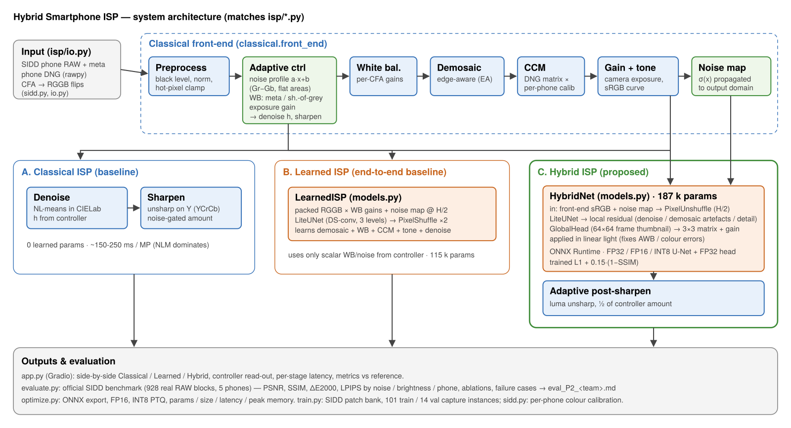
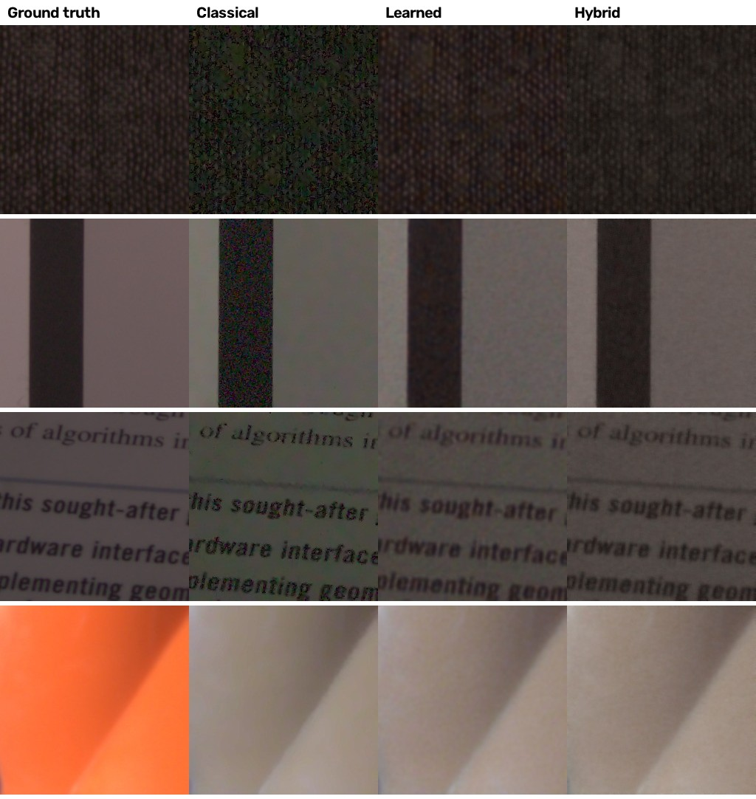
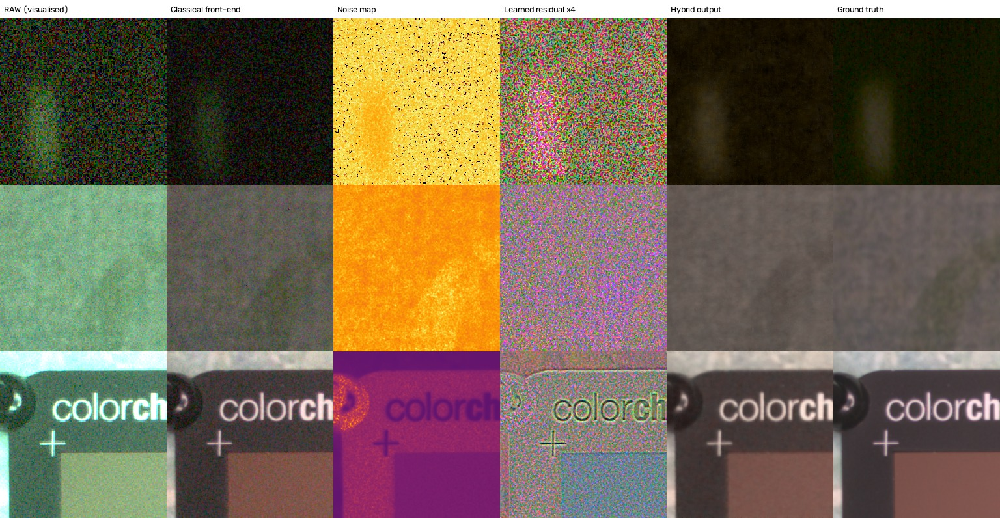

# Hackathon Technical Solution Report

| Field | Details |
| :--- | :--- |
| **Problem ID** | `P2` |
| **Problem Title** | `Intelligent & Computationally Efficient Smartphone ISP (Hybrid RAW → sRGB pipeline)` |
| **Team Name** | `Rebels` (Team ID T42) |
| **Team Members** | Titiksha Surana – 1RUA24CSE0507 · Pranaith Rushi Raju – 1RUA24CSE0509 · V Spandana – 1RUA24CSE0510 · Vaibhav K – 1RUA24CSE0511 |
| **GitHub Repository** | `https://github.com/spandana13-code/hybrid-isp` — evaluated commit `eaae99c` |
| **Live Demo / Deployment** | `https://huggingface.co/spaces/vspandana72/hybrid-isp` (web app on Hugging Face Spaces) |

---

## 1. Problem Understanding & Solution Strategy

* **Core Technical Challenge:** Turning real smartphone Bayer RAW into accurate sRGB. Small phone sensors produce strong **signal-dependent noise** (shot + read noise, ISO 50–10 000) that gets worse in dark scenes. Colour goes wrong in three ways: **white-balance error** (the official test set ships without metadata, so the illuminant must be estimated), **colour-matrix error** (the DNG matrix alone leaves a consistent red bias), and **demosaicing artefacts**. The constraints are mobile ones: a neural stage under 1 MB, about 100–300 ms per megapixel on 2 CPU threads, and modest memory. Quality must hold across five different phones and a wide range of noise and brightness levels.
* **Proposed Methodology:** We split the job by what each method does well. A **classical front-end** handles the stages that are cheap and known exactly from sensor physics and metadata: black level, CFA alignment, white balance, edge-aware demosaic, a calibrated colour matrix and gamma. A **187 k-parameter learned stage** then handles the parts where heuristics fail: denoising, artefact removal and residual colour correction. An **adaptive controller** measures the noise profile and illuminant from each frame and uses them to condition the network, set denoise and sharpening strength, and pick the white-balance source. We chose this over a static classical ISP, which loses about 3 dB, and over a pure end-to-end network: in FP32 the end-to-end net matches the hybrid's PSNR but has worse colour accuracy, loses 10× more quality under INT8, and has to be retrained for every new sensor.

---

## 2. Technical Architecture & Implementation

Architecture diagram: `docs/architecture.png`. Full design rationale: `docs/DESIGN.md`.

### 2.1 Classical Algorithmic Baseline

* **Algorithms Utilized** (`isp/classical.py`, `isp/sidd.py`):
  * **Bayer preprocessing:** black level, normalisation, lossless CFA → RGGB flips (the phones use RGGB, GRBG and BGGR), and a per-plane hot-pixel clamp.
  * **Noise estimation:** fits the model var(x) = a·x + b from the difference of the two green channels, (Gr − Gb)/√2, in flat regions, with a robust MAD per brightness bin.
  * **White balance:** the DNG `AsShotNeutral` when present; otherwise a shades-of-grey estimate (Minkowski p = 6) that excludes clipped and dark pixels.
  * **Demosaicing:** edge-aware interpolation (OpenCV EA).
  * **Colour correction:** DNG `ColorMatrix2` combined with a **per-phone 3×3 calibration** fitted by least squares on training frames.
  * **Tone:** sRGB OETF, plus auto-exposure and a highlight knee for simulated inputs.
  * **Denoising:** non-local means in CIELab, with chroma filtered 1.5× harder than luma. A bilateral filter in YCrCb is the fast option.
  * **Sharpening:** unsharp mask on luma only (YCrCb), with soft-thresholded detail.
* **Adaptive Selection Logic** (`analyze()` in `isp/classical.py`): one pass over the RAW gives the shot/read noise coefficients (a, b), the white-balance gains, the exposure gain and a scene label. From these, the controller predicts the output-domain noise σ_out by propagating the noise model through gain, colour matrix and gamma. That value sets the NLM filter strength (h ∝ σ_out) and the sharpening amount (0.7 − 6·σ_out, switched off for very noisy frames). The white-balance source switches automatically between metadata and estimation. The same statistics produce the per-pixel noise map and thumbnail that condition the hybrid network.

### 2.2 Deep Learning Pipeline

* **Model Architecture** (`isp/models.py`):
  * **LiteUNet**, a 3-level U-Net built from depthwise-separable residual blocks (24/48/96 channels). It needs about 8× fewer multiply-adds than standard 3×3 convolutions at the same width, which fits the mobile budget.
  * **LearnedISP**, the pure deep-learning baseline (PyNET / U-Net-ISP style, 115 k parameters). It maps packed RGGB plus a noise map directly to sRGB and has to learn demosaicing, colour correction, tone and denoising by itself.
  * **HybridNet**, our proposed model (187 k parameters). It combines the LiteUNet with a global colour/exposure head (details in §2.3).
  * We chose small custom CNNs over GAN or transformer models so the network stays under 1 MB, quantises cleanly to INT8 and runs at interactive speed on a CPU.
* **Loss Functions & Training** (`train.py`):
  * **Loss:** L1 + 0.15·(1 − SSIM) in sRGB. L1 drives pixel and colour fidelity; the SSIM term preserves structure and local contrast.
  * **Optimiser:** AdamW with a one-cycle learning rate (peak 2e-3), batch 16, 4 000 iterations; the best checkpoint is chosen by validation PSNR.
  * **Data:** **SIDD** (Smartphone Image Denoising Dataset; Abdelhamed et al., CVPR 2018), i.e. real noisy RAW from 5 phones (Google Pixel, iPhone 7, Nexus 6, LG G4, Galaxy S6) paired with clean sRGB ground truth.
  * **Splits:** 101 training and 14 validation capture instances (6 060 / 224 patches), stratified by phone. The **official 928-block SIDD benchmark** is used for testing only.

### 2.3 Hybrid Integration & Adaptive Mechanism

* **Fusion Strategy:** The network does not start from RAW. Its input is the **classical front-end output** (white-balanced, demosaiced, colour-corrected, gamma-encoded), stacked with the **per-pixel noise map** from the controller's noise model. Both are PixelUnshuffled to half resolution so the hybrid costs about the same as the baseline. The network has two outputs:
  1. **Local residual** (U-Net): denoising, demosaic-artefact removal and detail restoration, conditioned on the measured noise, so one network covers every ISO.
  2. **Global colour/exposure head**: looks at a fixed 64×64 thumbnail of the *whole frame* and predicts a 3×3 matrix M = I + 0.5·tanh(·) and a log-gain k. These are applied in **linear light**: y = OETF(M · EOTF(x + r) · eᵏ). This corrects residual white-balance and colour-matrix error. Because it is limited to a matrix and a gain, it cannot hallucinate spatial content.
  * A final **noise-gated luma sharpening** step stays classical, so it can be tuned at run time.
* **Decision Logic:**
  * **Noise vs. detail:** the noise map is computed per pixel from the fitted shot/read model at each pixel's signal level, propagated through gain and gamma. Dark regions therefore get a higher σ than bright ones in the same frame, and the U-Net denoises them harder. Bright, clean regions keep their texture.
  * **Post-sharpening** is scaled by 0.5 × the controller's sharpen amount. That amount goes to zero for very noisy frames, so sharpening never re-amplifies noise.
  * **Gain:** for real phone RAW the gain is 1, since the phone already set exposure. For under-exposed simulated inputs, the controller applies auto-exposure with a highlight knee so bright regions do not clip while shadows are lifted.

---

## 3. Experimental Benchmarks & Evaluation

All numbers come from the **official SIDD benchmark: 928 blocks of 256×256 real phone RAW** (29 capture instances, 5 phones), none of which were used in training, calibration or model selection. Reproduce with `python evaluate.py`; full tables are in `eval_P2_T42.md` and per-block rows in `results/eval_rows.json`.

### 3.1 Quantitative Benchmarks

| Approach / Model Variant | PSNR (dB) ↑ | SSIM ↑ | Perceptual Metric (LPIPS) ↓ | Latency (ms / frame, 1 MP) |
| :--- | :---: | :---: | :---: | :---: |
| **Classical Baseline** | 26.25 | 0.7241 | 0.4475 | 536 ms |
| **Deep Learning Only** (INT8, deployable) | 28.69 | 0.8637 | 0.2874 | 180 ms |
| *Deep Learning Only (FP32)* | *29.22* | *0.8828* | *0.2716* | *200 ms* |
| **Proposed Hybrid System** (INT8, deployed) | **29.12** | 0.8647 | 0.2855 | 285 ms |
| *Proposed Hybrid System (FP32)* | *29.17* | *0.8675* | *0.2773* | *346 ms* |

Colour accuracy (mean CIEDE2000 ΔE ↓): classical 10.65 · learned INT8 8.83 · **hybrid INT8 7.86** (best). Latency is the full pipeline (all classical stages plus the network) on a 1024×1024 real SIDD frame, using ONNX Runtime on 2 CPU threads. Model sizes are 488 KB for the hybrid INT8 and 202 KB for the learned INT8.

* **Analysis:**
  * **Hybrid vs. classical:** the hybrid beats the classical ISP by about **+2.9 dB PSNR, +0.14 SSIM and −0.16 LPIPS** while running about 1.9× faster. The learned denoiser replaces NL-means, which takes 87 % of the classical ISP's run time.
  * **Hybrid vs. pure learned:** in FP32 the two tie on PSNR. The learned ISP is slightly smoother (better SSIM/LPIPS), while the hybrid has the **best colour fidelity** (ΔE 7.85 vs 8.07).
  * **After INT8 quantisation:** the hybrid loses only 0.05 dB, while the pure learned ISP loses 0.53 dB. Among deployable models, the hybrid is therefore best on PSNR (+0.43 dB) and ΔE (−0.97), at the cost of about 100 ms extra latency for its classical front-end.

**Robustness (PSNR, hybrid INT8 vs classical):**

| Condition | Classical | Hybrid INT8 | Gain |
| :--- | :---: | :---: | :---: |
| Dark scenes | 26.37 | 31.92 | +5.6 dB |
| High noise | 24.81 | 27.88 | +3.1 dB |
| Bright scenes | 26.88 | 27.02 | +0.1 dB |

The gain holds on every phone, from Google Pixel (24.88 → 26.99 dB) to Galaxy S6 (28.06 → 30.89 dB).

### 3.2 Visual Outputs & Intermediate Representations

1. **Extreme low-light:** `docs/comparison.jpg`, row 1 (dark fabric, high noise; columns are ground truth | classical | learned | hybrid): classical NLM leaves blotchy chroma noise and a green cast, which the hybrid removes. `docs/intermediates.jpg`, row 1, shows a near-black, very noisy RAW block next to its enhanced output.
2. **Non-uniform / bright regions:** SIDD benchmark blocks are 256×256 crops with no backlit scenes, so we report this through the brightness-split results above (bright blocks: no loss versus classical, no clipping) and through `docs/intermediates.jpg`, row 3: a ColorChecker card with white text on a dark body, where highlights are kept without blow-out. Highlight clipping is handled by the controller's knee on simulated inputs; phone DNGs keep the phone's exposure (gain 1). All 58 test panels (blocks 0 and 13 of each test instance) are in `results/failure_cases/`.
3. **Intermediate states:** `docs/intermediates.jpg` (generated by `scripts/make_intermediates.py`) shows, for three test blocks: visualised Bayer RAW → **classical front-end output** (the network's input) → **measured per-pixel noise map** (the network's conditioning; brighter means noisier, normalised per row) → **learned residual** (network output minus its input, ×4; mostly noise removal in dark scenes, mostly edge and colour correction in the well-lit card) → hybrid output → ground truth. The web app's **Walk the pipeline** view shows these intermediates live for any input, stage by stage: sensor mosaic (each photosite in its filter colour), white balance, demosaic, colour matrix, tone curve, measured noise map, neural correction and output. It also states each adaptive-controller decision: noise σ, white-balance source and gains, denoise h and sharpen amount.

### 3.3 Ablation Study

Each module was disabled in turn on the same 928 test blocks (`evaluate.py`; extra networks trained via `train.py --model hybrid_nonoise / hybrid_noglobal`):

| Variant | PSNR | ΔE2000 | Δ vs. full | Finding |
| :--- | :---: | :---: | :---: | :--- |
| Hybrid ISP (FP32), full | 29.17 | 7.85 | – | – |
| Hybrid, front-end only (no network) | 23.93 | 13.69 | −5.24 dB | the learned stage adds +5.2 dB / −5.8 ΔE over its classical input |
| Hybrid, no global colour head | 29.02 | 8.26 | −0.15 dB | the head is worth −0.41 ΔE and +0.027 SSIM |
| Hybrid, no noise-map conditioning | 29.27 | 7.93 | +0.10 dB | no measurable gain on SIDD; the network infers noise from the image |
| Hybrid, no post-sharpen | 29.19 | 7.85 | +0.02 dB | neutral |
| Classical, no white balance | 19.81 | 19.86 | −6.44 dB vs classical | white balance is the most important single stage |
| Classical, nominal instead of calibrated CCM | 23.94 | 14.17 | −2.31 dB | per-phone calibration is essential |
| Classical, no denoise | 23.79 | 13.71 | −2.46 dB | – |
| Classical, fixed (non-adaptive) parameters | 26.41 | 10.62 | +0.16 dB | on SIDD the adaptive NLM rule does not help; its strength mapping over-smooths (a tuning gap) |
| Classical, bilateral instead of NLM | 27.35 | 9.99 | +1.10 dB | same over-smoothing issue |

**Precision ablation:** fully quantising the hybrid's 3×3 colour head to INT8 cost 0.45 dB. Mixed precision (U-Net INT8, head FP32) costs only 0.05 dB, which is why it is the deployed configuration.

---

## 4. Failure Modes & Limitations

* **Observed Failure Case 1: white balance on single-colour scenes.** This is the main failure: 42 of 928 blocks fall below 18 dB in *all three* pipelines. The worst block is instance 0020, block 21 (Google Pixel): hybrid 10.72 dB, ΔE 25.9. When a 256×256 block is one saturated colour (an orange cylinder, a yellow surface; `docs/comparison.jpg` row 4), the output is "neutralised" to beige.
* **Root Cause & Mitigation (case 1):** The test blocks carry no metadata, so the illuminant must be estimated. Shades-of-grey assumes the Minkowski mean of scene reflectance is achromatic, ‖ρ‖ₚ ∝ (1,1,1). A patch made of one chromatic surface breaks that assumption, so the estimator attributes the object's colour to the light and divides it out. Every pipeline inherits that estimate, and the learned global head cannot fix it because the patch contains no neutral reference. Mitigations:
  1. Use the phone's as-shot white balance whenever available (the app already does this for DNGs).
  2. Estimate on the full frame rather than a crop.
  3. Train a learned illuminant estimator (FC4 / FFCC-style) on SIDD's `AsShotNeutral` labels.

  Excluding these 42 blocks: classical 26.8, learned 29.9, hybrid 29.8 dB.
* **Observed Failure Case 2 (found during app testing): warm tint with metadata white balance.** When the white balance comes from phone DNG metadata, both networks sometimes add a warm cast (about +0.05 red), losing up to about 5 dB on some held-out scenes. **Cause:** half of the training crops used *estimated* white balance, whose errors have a systematic direction. The network could not tell trusted from untrusted white balance, so it always applied an "average" correction. **Fix (designed, not yet trained):** add a white-balance-source flag input (metadata vs. estimated) so the head only corrects when the estimate is untrusted, and train on 256–768 px crops to remove the thumbnail scale mismatch on full-size uploads. The benchmark numbers are unaffected because the test set has no metadata.
* **Other limitations:**
  * Google Pixel is the hardest phone (27.0 dB): its captures are darker and noisier.
  * The hybrid keeps slightly more residual grain than the learned ISP on flat dark areas (FP32 LPIPS 0.277 vs 0.272; after INT8 the hybrid is slightly ahead, 0.286 vs 0.287); a perceptual loss term would target this.
  * Training was short (101 captures, 4 000 iterations on CPU).
  * The metrics reward reproducing SIDD's reference rendering.
  * Latency is measured on an x86 CPU as a proxy for a phone; no NPU was measured.

---

## 5. Deployment & Quickstart Guide

### Quickstart Commands
```bash
# 1. Clone the repository and install dependencies
git clone https://github.com/spandana13-code/hybrid-isp
cd hybrid-isp
pip install -r requirements.txt

# 2. Run inference on a sample directory (all 3 pipelines; PNGs + metrics.csv)
python run_inference.py --input_dir ./examples/ --output_dir ./results/inference/ --pipeline all

# 3. Web app
python app.py                      # → http://localhost:7860

# 4. Reproduce the benchmark tables (needs the SIDD download, see README)
python evaluate.py --team T42 --usns "1RUA24CSE0510,1RUA24CSE0511,1RUA24CSE0509,1RUA24CSE0507"
```

### Deployment Format
* **Web app** (`app.py` + `web/index.html`): a custom front-end served through Gradio's server, with a JSON API (`/api/run`); the Gradio API stays available under `/gradio_api`. The repo also ships a `Dockerfile` (port 7860, honours `$PORT`) for container hosting; the live demo is hosted on Hugging Face Spaces at https://huggingface.co/spaces/vspandana72/hybrid-isp. The Space runs the same `app.py`, downloading this repository at start-up (launcher in `hf_space/`).
* Inference uses **ONNX Runtime** with the exported INT8 models (`models/*.onnx`), with FP16/FP32 selectable. PyTorch is not needed at runtime.
* The app accepts phone DNG/RAW, SIDD `.npz` blocks (with ground truth, so metrics are shown) and JPG/PNG (converted to a simulated sensor RAW). Two views: **Walk the pipeline** steps the image through all eight hybrid stages; **Compare results** shows classical, learned, hybrid and ground truth with a four-way magnifier under the cursor. Per-capture PSNR, ΔE and latency bars, the controller's decisions in plain language, and the benchmark charts are on the same page, with loading and error states. INT8/FP32 is switchable.
* A batch CLI is also provided (`run_inference.py`).

---

## Appendix: Figures

**Figure 1. System architecture** (classical front-end, adaptive controller, learned stage, post-processing).



**Figure 2. Official SIDD test blocks.** Columns: ground truth | classical | learned | hybrid. Rows: dark fabric (high noise), flat card, text, and the main failure case (single-colour orange object, white balance).



**Figure 3. Intermediate representations of the hybrid pipeline** (three SIDD test blocks). Columns: visualised RAW | classical front-end output (network input) | measured noise map | learned residual ×4 | hybrid output | ground truth.



---

### Student Submission Checklist
- [x] Working GitHub repository link included with an updated `README.md`.
- [x] No raw code pasted into this report.
- [x] All table metrics match test runs reproducible via the repository (`evaluate.py` → `eval_P2_T42.md`).
- [x] All team member details accurately recorded.
